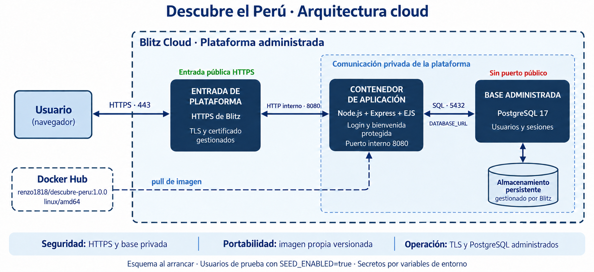
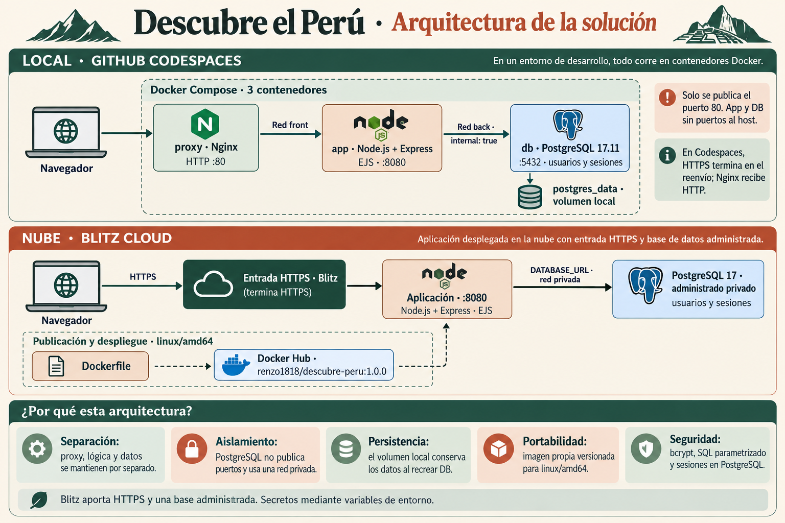

# Descubre el Perú

Aplicación de turismo del Perú con login contra PostgreSQL, saludo personalizado y bienvenida protegida. Presenta Machu Picchu, lago Titicaca, líneas de Nasca, Arequipa, Paracas e Iquitos con recursos CSS locales.

Esta guía incluye dos rutas: construir los archivos desde una carpeta vacía (sección 0) u obtener el proyecto existente (sección 1). Ambas continúan con configuración, tres contenedores, pruebas y publicación en Docker Hub y Blitz. Ejecuta los comandos Bash desde la raíz del proyecto indicado en cada etapa.

- Código completo: [rama dev](https://github.com/Renzo1818/-usil-cloud-lab/tree/dev).
- Imagen de referencia: [renzo1818/descubre-peru:1.0.0](https://hub.docker.com/r/renzo1818/descubre-peru).

## Arquitectura cloud y decisiones



El diagrama sigue la distribución del ejemplo académico y representa la solución desplegada en Blitz como una arquitectura lógica: entrada HTTPS de la plataforma, contenedor de aplicación y PostgreSQL administrado privado.

- **Entrada HTTPS gestionada:** Blitz cifra el acceso del navegador y dirige las solicitudes hacia la aplicación, que escucha internamente en el puerto 8080.
- **Imagen propia versionada:** Docker Hub distribuye `renzo1818/descubre-peru:1.0.0` para `linux/amd64`. La descarga ocurre durante el despliegue y no forma parte de cada petición del usuario.
- **Base administrada privada:** la aplicación accede a PostgreSQL mediante `DATABASE_URL`, sin exponer el puerto de la base a internet.
- **Persistencia administrada:** los usuarios y las sesiones permanecen en PostgreSQL al reiniciar o reemplazar la aplicación. El almacenamiento cloud es gestionado por Blitz; `postgres_data` corresponde al entorno local.
- **Inicialización reproducible:** la aplicación crea el esquema al arrancar y añade usuarios de prueba cuando `SEED_ENABLED=true`. Los secretos se proporcionan por variables de entorno.

El contenedor propio de este despliegue es la aplicación. La entrada HTTPS y PostgreSQL se muestran como servicios de la plataforma, sin atribuirles una implementación interna específica ni presentarlos como contenedores de nuestro Compose.

<details>
<summary>Prompts utilizados para generar la arquitectura cloud</summary>

Generación con la herramienta integrada de imágenes. La imagen del ejemplo del usuario se utilizó como referencia de composición.

```text
Use case: infographic-diagram. Genera una NUEVA imagen de arquitectura CLOUD de la aplicación "Descubre el Perú", en español. Imagen 1 es una REFERENCIA VISUAL: imita su distribución de cajas, fronteras discontinuas y flechas limpias, pero adapta los componentes a la arquitectura real de Blitz Cloud descrita abajo. No copies sus tres etiquetas de contenedores, porque nuestro despliegue usa servicios administrados. Formato horizontal, fondo blanco, azul marino y azul claro como la referencia, tipografía sans serif grande y precisa, diseño técnico sobrio para exposición universitaria, sin adornos ni personajes. Mantén todas las etiquetas perfectamente legibles.

Título superior: "Descubre el Perú · Arquitectura cloud".
Gran marco exterior discontinuo azul, que ocupa centro y derecha, con título "Blitz Cloud · Plataforma administrada".

Fuera de ese marco, a la izquierda, coloca caja azul claro "Usuario" / "(navegador)". Debajo del usuario, otra caja blanca discontinua "Docker Hub", seguida de "renzo1818/descubre-peru:1.0.0" y "linux/amd64".

Dentro del gran marco, tres componentes alineados horizontalmente:
1. Caja azul marino "ENTRADA DE PLATAFORMA" / "HTTPS de Blitz" / "TLS y certificado gestionados". Encima, etiqueta verde "Entrada pública HTTPS".
2. Caja azul marino "CONTENEDOR DE APLICACIÓN" / "Node.js + Express + EJS" / "Login y bienvenida protegida" / "Puerto interno 8080".
3. Caja azul marino "BASE ADMINISTRADA" / "PostgreSQL 17" / "Usuarios y sesiones". Encima, etiqueta roja "Sin puerto público".
NO etiquetar los tres elementos como contenedores. Solo la aplicación es un contenedor propio.

Conexiones de comunicación continuas y con puntas en ambos extremos: Usuario ↔ entrada HTTPS, con etiqueta "HTTPS · 443"; entrada HTTPS ↔ aplicación, con etiqueta "HTTP interno · 8080"; aplicación ↔ PostgreSQL, con etiqueta "SQL · 5432" y pequeña etiqueta "DATABASE_URL". No hay conexión directa del navegador ni de la entrada HTTPS con la base.

Una segunda frontera discontinua azul claro dentro de Blitz rodea únicamente aplicación y base; etiqueta "Comunicación privada de la plataforma". Debajo de la base, conecta un cilindro "Almacenamiento persistente" / "gestionado por Blitz". Esto es persistencia del servicio administrado, NO un volumen Docker creado por nuestro proyecto.

Desde la caja Docker Hub, dibuja una flecha discontinua de despliegue que entra al marco y termina en la caja de aplicación, con etiqueta "pull de imagen". Haz que ese trazado pase por debajo de la entrada HTTPS sin cruzar flechas de usuario. Docker Hub NO aparece en la ruta de una petición web.

Franja inferior muy breve de tres justificaciones: "Seguridad: HTTPS y base privada" · "Portabilidad: imagen propia versionada" · "Operación: TLS y PostgreSQL administrados".
Nota pequeña al pie: "La app inicializa tablas y usuarios al arrancar. Secretos mediante variables de entorno."

Precisión: la imagen debe mostrar solo cloud. No dibujar Codespaces, Docker Compose, red back, Nginx propio ni postgres_data. No inventar implementación interna, balanceadores extra, escalado automático, URLs públicas, passwords ni tokens. Usa solo los componentes descritos.
```

Ajuste final de la nota de inicialización, conservando el resto del diagrama:

```text
Edita únicamente la nota inferior de esta imagen. Conserva exactamente toda la composición, colores, cajas, diagramas, flechas, etiquetas y resolución. Sustituye la frase inferior "La app inicializa tablas y usuarios al arrancar. Secretos mediante variables de entorno." por este texto exacto, centrado y completamente legible: "Esquema al arrancar · Usuarios de prueba con SEED_ENABLED=true · Secretos por variables de entorno". No hagas ningún otro cambio.
```

</details>

<details>
<summary>Diagrama comparativo anterior: entorno local y cloud</summary>




- **Separación de servicios:** Nginx concentra la entrada HTTP, Express ejecuta la lógica y PostgreSQL almacena usuarios y sesiones. Cada componente tiene una responsabilidad definida.
- **Aislamiento de la base:** solo Nginx publica el puerto 80; app y DB comparten la red interna `back`. El proxy no pertenece a esa red.
- **Persistencia local:** el volumen `postgres_data` conserva los datos cuando se recrea el contenedor PostgreSQL. En Blitz el almacenamiento pertenece a la base administrada.
- **Portabilidad:** una imagen propia versionada para `linux/amd64` permite trasladar la aplicación desde Docker Hub a Blitz con su configuración de ejecución.
- **Autenticación segura:** bcrypt protege las contraseñas almacenadas, las consultas parametrizadas separan datos y SQL, y PostgreSQL conserva las sesiones fuera del proceso Node.
- **Servicios administrados en nube:** Blitz proporciona la entrada HTTPS y PostgreSQL privado. El despliegue cloud utiliza la app desde Docker Hub, sin trasladar el Compose local ni su Nginx.

La imagen se generó con la herramienta integrada de generación de imágenes a partir de `docker-compose.yml`, Dockerfile y el código de autenticación del proyecto. Las flechas discontinuas representan publicación y despliegue; las continuas, comunicación durante el uso de la aplicación.

<details>
<summary>Prompt utilizado para generar el diagrama</summary>

```text
Use case: infographic-diagram. Crea una infografía técnica original, horizontal, de alta resolución, en español, para el informe académico de una aplicación de turismo del Perú. Título exacto: "Descubre el Perú · Arquitectura de la solución". Estética editorial limpia, fondo arena claro, verde oscuro y terracota, líneas nítidas, iconos técnicos sencillos y texto grande legible. Sin fotografías ni decoración que dificulte leer. Composición en dos franjas de arquitectura y una franja inferior de justificación. Mantén correctos los acentos y todas las etiquetas.

FRANJA 1: "LOCAL · GITHUB CODESPACES". Flujo de izquierda a derecha: navegador externo → Nginx → aplicación → PostgreSQL. Un marco "Docker Compose · 3 contenedores" encierra solo Nginx, app y PostgreSQL; debajo de DB hay un símbolo de almacenamiento, que NO es otro contenedor.
Etiquetas de los nodos: "Navegador"; "proxy · Nginx" y "HTTP :80"; "app · Node.js + Express" y "EJS · :8080"; "db · PostgreSQL 17.11" y ":5432 · usuarios y sesiones".
Conector Nginx→app: "Red front". Conector app→DB: "Red back · internal: true". Una conexión DB→almacenamiento etiquetado "postgres_data · volumen local".
Nota visible: "Solo se publica el puerto 80. App y DB sin puertos al host." Otra nota: "En Codespaces, HTTPS termina en el reenvío; Nginx recibe HTTP." No dibujes conexión Nginx→DB. La app participa en ambas redes, DB solo en back.

FRANJA 2: "NUBE · BLITZ CLOUD". Flujo navegador → "Entrada HTTPS · Blitz" → "Aplicación · :8080" → "PostgreSQL 17 · administrado privado". La conexión HTTPS exterior termina en la entrada de Blitz. Conector app→DB: "DATABASE_URL · red privada". DB almacena "usuarios y sesiones". No dibujes un Nginx propio ni un volumen Docker ni un contenedor DB propio en Blitz.
En una pequeña línea de despliegue separada de las peticiones web: "Dockerfile" → "Docker Hub · renzo1818/descubre-peru:1.0.0" → aplicación cloud. Etiqueta esa línea "Publicación y despliegue · linux/amd64", con trazos discontinuos. Docker Hub NO forma parte del recorrido de una petición del usuario. Las bases local y cloud son independientes y NO están conectadas entre sí.

FRANJA INFERIOR: título "¿Por qué esta arquitectura?" y cinco tarjetas compactas, con estas frases exactas:
"Separación: proxy, lógica y datos se mantienen por separado."
"Aislamiento: PostgreSQL no publica puertos y usa una red privada."
"Persistencia: el volumen local conserva los datos al recrear DB."
"Portabilidad: imagen propia versionada para linux/amd64."
"Seguridad: bcrypt, SQL parametrizado y sesiones en PostgreSQL."
Pequeña nota final: "Blitz aporta HTTPS y una base administrada. Secretos mediante variables de entorno."

Prioriza exactitud técnica, jerarquía visual y legibilidad. No incluir contraseñas, tokens, URLs inventadas, promesas de escalado automático ni servicios adicionales.
```

</details>

</details>

## 0. Construir desde una carpeta vacía

Esta ruta crea los archivos de la aplicación sin clonar el proyecto. Si quieres ejecutar el código existente, utiliza la ruta de clonación de la sección 1. Después de completar esta sección, continúa en la sección 2; no vuelvas a clonar sobre el proyecto recién creado.

Usa una terminal **Bash en Linux**, con Node.js 24, npm, Git, Docker y Docker Compose disponibles. Para la actividad, puedes hacer la creación en una terminal de Codespaces que ya tenga esas herramientas. Los comandos construyen una aplicación nueva dentro de `descubre-peru`; esa carpeta no debe existir previamente. Si falla su creación, detente y elige una ubicación libre antes de continuar.

Los bloques siguientes contienen el código de esta implementación. Cópialos completos y en orden, usando la misma terminal. No incluyen `.env` ni secretos; el archivo privado se genera en la sección 2. Al cambiar la implementación, estos bloques también deberán actualizarse.

### 0.1. Comprobar las herramientas

```bash
bash --version
git --version
node --version
npm --version
docker version
docker compose version
docker buildx version
```

Docker debe mostrar cliente y servidor. Esta ruta presupone el entorno de desarrollo preparado, no una instalación de Linux sin herramientas. La configuración de Codespaces que se crea abajo se aplicará al abrir un Codespace del nuevo repositorio o al reconstruir su contenedor de desarrollo.

### 0.2. Crear directorios, Git, package.json y lockfile

```bash
mkdir descubre-peru || exit 1
cd descubre-peru || exit 1
git init -b dev
mkdir -p .devcontainer src/views src/public db/migrations nginx scripts tests
npm init -y
npm pkg set name=descubre-peru version=1.0.0 type=module 'engines.node=>=24 <25'
npm pkg set private=true --json
npm pkg delete main description keywords author license directories
npm pkg set \
  'scripts.start=node scripts/init-db.js && node src/server.js' \
  'scripts.init-db=node scripts/init-db.js' \
  'scripts.generate-env=node scripts/generate-env.js' \
  'scripts.test=node tests/config.test.js && node tests/auth.test.js' \
  'scripts.smoke=node scripts/smoke-test.js' \
  'scripts.verify-persistence=bash scripts/verify-persistence.sh'
npm install --save-exact --no-audit --no-fund \
  express@5.3.0 ejs@7.0.2 pg@8.23.1 bcrypt@6.0.0 \
  express-session@1.19.0 connect-pg-simple@10.0.0 \
  helmet@8.3.0 express-rate-limit@8.7.1
```

`npm init` crea el manifiesto; `npm pkg set` configura módulos ES, scripts y el indicador privado como booleano. `npm install --save-exact` fija las dependencias directas y genera `package-lock.json`, necesario para `npm ci` en Docker. El lockfile se genera a partir del registro vigente: consérvalo en Git para repetir exactamente esa instalación; no se garantiza que sus dependencias transitivas coincidan con las de un lockfile generado en otra fecha.

### 0.3. Crear exclusiones, variables de ejemplo y contenedores

```bash
cat > .gitignore <<'ARCHIVO_PERU_1'
/context.md
.env
.env.*
!.env.example
node_modules/
coverage/
*.log
*.cookies
playwright-report/
test-results/
.tmp/
ARCHIVO_PERU_1

cat > .dockerignore <<'ARCHIVO_PERU_2'
.git
.agents
.codex
.aws
.env
.env.*
!.env.example
node_modules
coverage
*.log
*.cookies
tests
README.md
context.md
index.html
.tmp
test-results
playwright-report
ARCHIVO_PERU_2

cat > .env.example <<'ARCHIVO_PERU_3'
NODE_ENV=production
PORT=8080
POSTGRES_DB=turismo
POSTGRES_USER=turismo
POSTGRES_PASSWORD=REEMPLAZAR
DATABASE_URL=postgresql://turismo:REEMPLAZAR@db:5432/turismo
SESSION_SECRET=REEMPLAZAR_POR_SECRETO_ALEATORIO
COOKIE_SECURE=false
PROXY_SCHEME=http
TRUST_PROXY=172.30.10.2
SEED_ENABLED=true
SEED_USER1_PASSWORD=REEMPLAZAR
SEED_USER2_PASSWORD=REEMPLAZAR
DOCKERHUB_USERNAME=
APP_VERSION=1.0.0
ARCHIVO_PERU_3

cat > .devcontainer/devcontainer.json <<'ARCHIVO_PERU_4'
{
  "name": "Descubre el Perú",
  "image": "mcr.microsoft.com/devcontainers/base:ubuntu-24.04",
  "features": {
    "ghcr.io/devcontainers/features/docker-in-docker:2": {},
    "ghcr.io/devcontainers/features/node:1": { "version": "24" }
  },
  "forwardPorts": [80],
  "portsAttributes": {
    "80": { "label": "Descubre el Perú", "onAutoForward": "notify", "visibility": "private" }
  }
}
ARCHIVO_PERU_4

cat > Dockerfile <<'ARCHIVO_PERU_5'
FROM node:24.21.0-bookworm-slim
ENV NODE_ENV=production
WORKDIR /app
COPY package.json package-lock.json ./
RUN npm ci --omit=dev --no-audit --no-fund && npm cache clean --force
COPY --chown=node:node src ./src
COPY --chown=node:node scripts ./scripts
COPY --chown=node:node db ./db
USER node
EXPOSE 8080
CMD ["sh", "scripts/start.sh"]
ARCHIVO_PERU_5

cat > docker-compose.yml <<'ARCHIVO_PERU_6'
services:
  proxy:
    image: nginx:1.28.0-alpine
    ports:
      - "80:80"
    environment:
      PROXY_SCHEME: ${PROXY_SCHEME:-http}
    volumes:
      - ./nginx/default.conf.template:/etc/nginx/templates/default.conf.template:ro
    depends_on:
      app:
        condition: service_healthy
    networks:
      front:
        ipv4_address: 172.30.10.2
    healthcheck:
      test: ["CMD", "wget", "-q", "--spider", "http://127.0.0.1/health"]
      interval: 10s
      timeout: 5s
      retries: 5
    restart: unless-stopped
  app:
    image: descubre-peru:${APP_VERSION:-1.0.0}
    platform: linux/amd64
    build: .
    environment:
      NODE_ENV: ${NODE_ENV:-production}
      PORT: "8080"
      DATABASE_URL: ${DATABASE_URL:?Genera .env antes de iniciar}
      SESSION_SECRET: ${SESSION_SECRET:?Genera .env antes de iniciar}
      COOKIE_SECURE: ${COOKIE_SECURE:-false}
      TRUST_PROXY: ${TRUST_PROXY:-172.30.10.2}
      SEED_ENABLED: ${SEED_ENABLED:-false}
      SEED_USER1_PASSWORD: ${SEED_USER1_PASSWORD:-}
      SEED_USER2_PASSWORD: ${SEED_USER2_PASSWORD:-}
    depends_on:
      db:
        condition: service_healthy
    networks:
      front:
        ipv4_address: 172.30.10.3
      back: {}
    healthcheck:
      test: ["CMD", "node", "-e", "fetch('http://127.0.0.1:8080/ready').then(r=>process.exit(r.ok?0:1)).catch(()=>process.exit(1))"]
      interval: 10s
      timeout: 6s
      retries: 10
      start_period: 30s
    init: true
    restart: unless-stopped
  db:
    image: postgres:17.11-bookworm
    environment:
      POSTGRES_DB: ${POSTGRES_DB:?Genera .env antes de iniciar}
      POSTGRES_USER: ${POSTGRES_USER:?Genera .env antes de iniciar}
      POSTGRES_PASSWORD: ${POSTGRES_PASSWORD:?Genera .env antes de iniciar}
    volumes:
      - postgres_data:/var/lib/postgresql/data
    networks:
      - back
    healthcheck:
      test: ["CMD-SHELL", "pg_isready -U \"$$POSTGRES_USER\" -d \"$$POSTGRES_DB\""]
      interval: 5s
      timeout: 5s
      retries: 10
    restart: unless-stopped
networks:
  front:
    ipam:
      config:
        - subnet: 172.30.10.0/24
  back:
    internal: true
volumes:
  postgres_data:
ARCHIVO_PERU_6

cat > nginx/default.conf.template <<'ARCHIVO_PERU_7'
server {
    listen 80;
    server_tokens off;
    client_max_body_size 8k;
    location / {
        proxy_pass http://app:8080;
        proxy_http_version 1.1;
        proxy_set_header Host $host;
        proxy_set_header X-Forwarded-For $remote_addr;
        proxy_set_header X-Forwarded-Proto ${PROXY_SCHEME};
        proxy_set_header X-Real-IP $remote_addr;
        proxy_connect_timeout 5s;
        proxy_read_timeout 15s;
    }
}
ARCHIVO_PERU_7

cat > db/migrations/001_init.sql <<'ARCHIVO_PERU_8'
CREATE TABLE IF NOT EXISTS users (
  id integer GENERATED ALWAYS AS IDENTITY PRIMARY KEY,
  username varchar(64) UNIQUE NOT NULL,
  password_hash text NOT NULL,
  full_name varchar(120) NOT NULL,
  created_at timestamptz NOT NULL DEFAULT now()
);
CREATE TABLE IF NOT EXISTS session (
  sid varchar PRIMARY KEY,
  sess json NOT NULL,
  expire timestamp(6) NOT NULL
);
CREATE INDEX IF NOT EXISTS session_expire_idx ON session (expire);
ARCHIVO_PERU_8
```

### 0.4. Crear la aplicación, las vistas y el diseño

```bash
cat > src/config.js <<'ARCHIVO_PERU_1'
export function readConfig(env = process.env) {
  const required = name => {
    if (!env[name]) throw new Error(`Falta la variable ${name}.`);
    return env[name];
  };
  const bool = (name, fallback = 'false') => {
    const value = env[name] ?? fallback;
    if (!['true', 'false'].includes(value)) throw new Error(`${name} debe ser true o false.`);
    return value === 'true';
  };
  const databaseUrl = required('DATABASE_URL');
  try {
    const parsed = new URL(databaseUrl);
    if (!['postgres:', 'postgresql:'].includes(parsed.protocol)) throw new Error();
  } catch { throw new Error('DATABASE_URL debe ser una URL PostgreSQL válida.'); }
  const sessionSecret = required('SESSION_SECRET');
  if (Buffer.byteLength(sessionSecret) < 32) throw new Error('SESSION_SECRET requiere al menos 32 bytes.');
  const port = Number(env.PORT ?? 8080);
  if (!Number.isInteger(port) || port < 1 || port > 65535) throw new Error('PORT inválido.');
  const proxy = env.TRUST_PROXY ?? 'false';
  // Solo direcciones/subredes explícitas; nunca confiar en un número arbitrario de saltos.
  const parts = proxy.split(',').map(v => v.trim());
  const { isIP } = process.getBuiltinModule('node:net');
  const valid = value => {
    if (value === 'loopback') return true;
    const [ip, mask, extra] = value.split('/');
    const family = isIP(ip);
    return !extra && family && (mask === undefined || (/^\d+$/.test(mask) && Number(mask) > 0 && Number(mask) <= (family === 4 ? 32 : 128)));
  };
  if (proxy !== 'false' && !parts.every(valid)) throw new Error('TRUST_PROXY requiere false, loopback o IP/CIDR explícitas.');
  const seed = bool('SEED_ENABLED');
  const seedPasswords = seed ? [required('SEED_USER1_PASSWORD'), required('SEED_USER2_PASSWORD')] : [];
  if (seedPasswords.some(p => Buffer.byteLength(p) < 12 || Buffer.byteLength(p) > 72)) {
    throw new Error('Los passwords de seed requieren entre 12 y 72 bytes.');
  }
  return { databaseUrl, sessionSecret, port, secure: bool('COOKIE_SECURE'),
    trustProxy: proxy === 'false' ? false : parts, seed, seedPasswords };
}
ARCHIVO_PERU_1

cat > src/db.js <<'ARCHIVO_PERU_2'
import pg from 'pg';
export function createPool(connectionString) {
  const pool = new pg.Pool({ connectionString, max: 5, connectionTimeoutMillis: 5000, idleTimeoutMillis: 30000 });
  pool.on('error', () => console.error('Conexión inactiva a PostgreSQL interrumpida.'));
  return pool;
}
ARCHIVO_PERU_2

cat > src/app.js <<'ARCHIVO_PERU_3'
import express from 'express';
import session from 'express-session';
import connectPgSimple from 'connect-pg-simple';
import helmet from 'helmet';
import { rateLimit } from 'express-rate-limit';
import bcrypt from 'bcrypt';
import { randomBytes, timingSafeEqual } from 'node:crypto';
import { fileURLToPath } from 'node:url';

const destinations = [
  { name: 'Machu Picchu', region: 'Cusco · Sierra', style: 'andes', icon: '◭', text: 'Terrazas de piedra y montañas que guardan la memoria de los incas.' },
  { name: 'Lago Titicaca', region: 'Puno · Sierra', style: 'lago', icon: '≈', text: 'Un horizonte de agua y tradiciones vivas en el altiplano peruano.' },
  { name: 'Líneas de Nasca', region: 'Ica · Costa', style: 'desierto', icon: '✳', text: 'Trazos ancestrales que convierten el desierto en un paisaje de preguntas.' },
  { name: 'Arequipa', region: 'Arequipa · Sierra', style: 'ciudad', icon: '⌂', text: 'Arquitectura de sillar, sabores propios y volcanes en el horizonte.' },
  { name: 'Paracas', region: 'Ica · Costa', style: 'mar', icon: '∿', text: 'El encuentro del desierto con el Pacífico: acantilados, playas y vida marina.' },
  { name: 'Iquitos', region: 'Loreto · Selva', style: 'selva', icon: '❋', text: 'Una puerta a los ríos, los bosques y la diversidad de la Amazonía.' }
];
export async function createApp(config, pool) {
  const app = express();
  app.disable('x-powered-by');
  app.set('trust proxy', config.trustProxy);
  let reportedProxy = false;
  app.use((req, _res, next) => {
    if (config.secure && config.trustProxy === false && !reportedProxy && req.headers['x-forwarded-proto'] === 'https') {
      console.info(`Entrada HTTPS observada desde ${req.socket.remoteAddress}. Verifica esta dirección del proxy antes de configurar TRUST_PROXY.`);
      reportedProxy = true;
    }
    next();
  });
  app.set('view engine', 'ejs');
  app.set('views', fileURLToPath(new URL('./views', import.meta.url)));
  app.use(helmet({ contentSecurityPolicy: { directives: { 'upgrade-insecure-requests': config.secure ? [] : null } } }));
  app.get('/health', (_req, res) => res.json({ status: 'ok' }));
  app.get('/ready', async (_req, res) => {
    try { await pool.query('SELECT 1'); res.json({ status: 'ready' }); }
    catch { res.status(503).json({ status: 'unavailable' }); }
  });
  app.use('/assets', express.static(fileURLToPath(new URL('./public', import.meta.url)), { maxAge: '1h' }));
  app.use(express.urlencoded({ extended: false, limit: '4kb', parameterLimit: 10 }));
  const Store = connectPgSimple(session);
  app.use(session({
    name: 'peru.sid', secret: config.sessionSecret,
    store: new Store({ pool, tableName: 'session', createTableIfMissing: false,
      errorLog: () => console.error('Error del almacén de sesiones.') }),
    resave: false, saveUninitialized: false,
    cookie: { httpOnly: true, sameSite: 'lax', secure: config.secure, maxAge: 30 * 60 * 1000 }
  }));
  app.use((req, res, next) => {
    res.set('Cache-Control', 'no-store');
    req.session.csrf ??= randomBytes(32).toString('hex');
    res.locals.csrf = req.session.csrf;
    next();
  });
  app.use((req, res, next) => {
    if (req.method !== 'POST') return next();
    const supplied = req.body?._csrf;
    const expected = req.session.csrf;
    if (typeof supplied !== 'string' || !/^[a-f0-9]{64}$/.test(supplied) || supplied.length !== expected.length ||
      !timingSafeEqual(Buffer.from(supplied), Buffer.from(expected))) {
      return res.status(403).send('Solicitud no válida. Recarga el formulario e inténtalo nuevamente.');
    }
    next();
  });
  const dummyHash = await bcrypt.hash(randomBytes(32).toString('hex'), 12);
  const loginLimit = rateLimit({ windowMs: 15 * 60 * 1000, limit: 10,
    standardHeaders: 'draft-8', legacyHeaders: false,
    message: 'Demasiados intentos. Vuelve a intentarlo en 15 minutos.' });
  app.get('/', (req, res) => res.redirect(req.session.userId ? '/welcome' : '/login'));
  app.get('/login', (req, res) => {
    if (req.session.userId) return res.redirect('/welcome');
    res.render('login', { error: null });
  });
  app.post('/login', loginLimit, async (req, res) => {
    const { username, password } = req.body;
    const fail = () => res.status(401).render('login', { error: 'Usuario o contraseña incorrectos' });
    if (typeof username !== 'string' || typeof password !== 'string' ||
      username.trim().length < 1 || username.length > 64 || password.length < 1 || Buffer.byteLength(password) > 72) return fail();
    const result = await pool.query('SELECT id, password_hash FROM users WHERE username = $1', [username.trim()]);
    const user = result.rows[0];
    const valid = await bcrypt.compare(password, user?.password_hash ?? dummyHash);
    if (!valid || !user) return fail();
    await new Promise((resolve, reject) => req.session.regenerate(error => error ? reject(error) : resolve()));
    req.session.userId = user.id;
    req.session.csrf = randomBytes(32).toString('hex');
    await new Promise((resolve, reject) => req.session.save(error => error ? reject(error) : resolve()));
    res.redirect('/welcome');
  });
  app.get('/welcome', async (req, res) => {
    if (!req.session.userId) return res.redirect('/login');
    const result = await pool.query('SELECT full_name FROM users WHERE id = $1', [req.session.userId]);
    if (!result.rowCount) return req.session.destroy(() => res.redirect('/login'));
    res.render('welcome', { name: result.rows[0].full_name, destinations });
  });
  app.post('/logout', (req, res, next) => {
    req.session.destroy(error => {
      if (error) return next(error);
      res.clearCookie('peru.sid', { path: '/', httpOnly: true, sameSite: 'lax', secure: config.secure });
      res.redirect('/login');
    });
  });
  app.use((_req, res) => res.status(404).send('Página no encontrada.'));
  app.use((error, _req, res, _next) => {
    const badInput = error.status === 400 || error.status === 413;
    if (!badInput) console.error('No se pudo completar una solicitud.');
    res.status(badInput ? error.status : 503).send(badInput ? 'Formulario no válido.' : 'Servicio temporalmente no disponible. Inténtalo nuevamente.');
  });
  return app;
}
ARCHIVO_PERU_3

cat > src/server.js <<'ARCHIVO_PERU_4'
import { readConfig } from './config.js';
import { createPool } from './db.js';
import { createApp } from './app.js';
let pool;
try {
  const config = readConfig();
  pool = createPool(config.databaseUrl);
  const app = await createApp(config, pool);
  const server = app.listen(config.port, '0.0.0.0', () => console.log(`Descubre el Perú escucha en el puerto ${config.port}.`));
  server.on('error', async () => { console.error('No se pudo abrir el puerto de la aplicación.'); await pool.end(); process.exitCode = 1; });
  const shutdown = () => {
    const timeout = setTimeout(() => process.exit(1), 10000).unref();
    server.close(async () => { await pool.end(); clearTimeout(timeout); process.exit(0); });
  };
  process.once('SIGTERM', shutdown);
  process.once('SIGINT', shutdown);
} catch (error) {
  console.error(error.message);
  if (pool) await pool.end();
  process.exitCode = 1;
}
ARCHIVO_PERU_4

cat > src/views/login.ejs <<'ARCHIVO_PERU_5'
<!doctype html>
<html lang="es">
<head><meta charset="utf-8"><meta name="viewport" content="width=device-width, initial-scale=1"><meta name="theme-color" content="#a63d2f"><title>Descubre el Perú · Iniciar sesión</title><link rel="stylesheet" href="/assets/styles.css"></head>
<body class="login-page">
<a class="skip" href="#contenido">Ir al contenido</a>
<header class="site-header"><a class="brand" href="/">PERÚ<span>un viaje que se queda contigo</span></a><span class="header-note">COSTA · SIERRA · SELVA</span></header>
<main id="contenido" class="login-layout">
<section class="intro"><p class="eyebrow">MIL PAISAJES. UN SOLO PAÍS.</p><h1>Descubre<br>el <em>Perú.</em></h1><p class="lead">Entre el Pacífico, los Andes y la Amazonía, tu próxima historia está por comenzar.</p>
<div class="landscape" role="img" aria-label="Ilustración de montañas andinas, sol y río"><span class="sun"></span><span class="mountain far"></span><span class="mountain near"></span><span class="river"></span><span class="landscape-label">UN TERRITORIO DE ENCUENTROS</span></div>
<div class="region-labels"><span>01 / Costa</span><span>02 / Sierra</span><span>03 / Selva</span></div>
</section>
<section class="login-card" aria-labelledby="login-title"><p class="eyebrow">TU VIAJE EMPIEZA AQUÍ</p><h2 id="login-title">Un país por explorar</h2><p>Inicia sesión para descubrir destinos que inspiran.</p>
<% if (error) { %><p class="error" role="alert"><%= error %></p><% } %>
<form action="/login" method="post"><input type="hidden" name="_csrf" value="<%= csrf %>">
<label for="username">Usuario</label><input id="username" name="username" autocomplete="username" maxlength="64" required placeholder="Tu usuario">
<label for="password">Contraseña</label><input id="password" name="password" type="password" autocomplete="current-password" maxlength="72" required placeholder="Tu contraseña">
<button type="submit">Comenzar a explorar <span aria-hidden="true">↗</span></button>
</form><p class="form-note">Acceso para usuarios de demostración.<br>Un recorrido por la diversidad del Perú.</p></section>
</main><footer>Hecho para explorar, aprender y conectar.<span>PERÚ · TURISMO Y CULTURA</span></footer>
</body></html>
ARCHIVO_PERU_5

cat > src/views/welcome.ejs <<'ARCHIVO_PERU_6'
<!doctype html>
<html lang="es">
<head><meta charset="utf-8"><meta name="viewport" content="width=device-width, initial-scale=1"><meta name="theme-color" content="#a63d2f"><title>Explora destinos · Descubre el Perú</title><link rel="stylesheet" href="/assets/styles.css"></head>
<body><a class="skip" href="#contenido">Ir al contenido</a>
<header class="site-header"><a class="brand" href="/">PERÚ<span>un viaje que se queda contigo</span></a><form action="/logout" method="post"><input type="hidden" name="_csrf" value="<%= csrf %>"><button class="logout" type="submit">Cerrar sesión <span aria-hidden="true">↗</span></button></form></header>
<main id="contenido" class="explore"><section class="welcome-intro"><p class="eyebrow">EL VIAJE ES TUYO</p><h1>Bienvenido, <%= name %></h1><p class="lead">Seis destinos, infinitas formas de sentir el Perú.</p><div class="region-pills"><span>Costa</span><span>Sierra</span><span>Selva</span></div></section>
<section aria-labelledby="destinos-title"><div class="section-heading"><h2 id="destinos-title">Lugares que dejan huella</h2><span>UNA MIRADA AL PERÚ / 01—06</span></div>
<div class="destinations"><% destinations.forEach((destination, index) => { %>
<article class="destination"><div class="destination-art <%= destination.style %>" aria-hidden="true"><span class="art-number">0<%= index + 1 %></span><span class="art-icon"><%= destination.icon %></span><span class="art-caption"><%= destination.name %></span></div><div class="destination-body"><p class="eyebrow"><%= destination.region %></p><h3><%= destination.name %></h3><p><%= destination.text %></p></div></article>
<% }); %></div></section><aside class="travel-note"><span aria-hidden="true">✳</span><div><h2>Viaja con respeto</h2><p>Cuida los paisajes, valora las comunidades y lleva contigo solo recuerdos.</p></div></aside></main>
<footer>Hecho para explorar, aprender y conectar.<span>PERÚ · TURISMO Y CULTURA</span></footer>
</body></html>
ARCHIVO_PERU_6

cat > src/public/styles.css <<'ARCHIVO_PERU_7'
:root{--paper:#f7f2e9;--ink:#283c32;--muted:#5d665c;--red:#a63d2f;--line:#d8d3c7;--serif:Georgia,'Times New Roman',serif}*{box-sizing:border-box}body{margin:0;background:var(--paper);color:var(--ink);font:16px/1.6 system-ui,-apple-system,sans-serif}a{color:inherit}button,input{font:inherit}:focus-visible{outline:3px solid #146b86;outline-offset:4px}.skip{position:absolute;left:16px;top:-100px;z-index:5;background:white;padding:12px}.skip:focus{top:12px}.site-header{max-width:1440px;margin:auto;padding:28px 6%;display:flex;align-items:center;justify-content:space-between;border-bottom:1px solid var(--line);gap:20px}.brand{font-size:32px;font-weight:900;letter-spacing:-2px;text-decoration:none;color:var(--red);line-height:1}.brand span{display:block;font-size:10px;letter-spacing:1px;font-weight:500;margin-top:9px;color:var(--ink)}.header-note,.eyebrow{font-size:11px;font-weight:700;letter-spacing:2px}.header-note{color:var(--muted)}.login-layout{max-width:1240px;margin:64px auto 72px;display:grid;grid-template-columns:1.2fr 1fr;gap:100px;padding:0 40px;align-items:center}.eyebrow{color:var(--red);margin:0 0 18px}h1,h2,h3,p{overflow-wrap:anywhere}h1{font-family:var(--serif);font-size:clamp(56px,7vw,94px);line-height:1.02;font-weight:400;letter-spacing:-3px;margin:20px 0 24px}h1 em{color:var(--red);font-weight:400}.lead{font-size:17px;max-width:450px;color:var(--muted);line-height:1.8}.landscape{height:210px;position:relative;overflow:hidden;border-radius:110px 110px 4px 4px;background:#e8cfa9;margin-top:34px}.sun{position:absolute;width:75px;height:75px;border-radius:50%;background:#bd583b;left:64%;top:22px}.mountain{position:absolute;width:110%;height:230px;clip-path:polygon(0 100%,25% 10%,39% 47%,57% 0,100% 100%)}.far{background:#65816f;top:35px;left:-40px}.near{background:#2c5146;top:90px;left:20px;transform:scaleX(-1)}.river{position:absolute;width:240px;height:160px;border:24px solid #a5beb2;border-radius:50%;transform:rotate(-25deg);bottom:-136px;left:25%}.landscape-label{position:absolute;bottom:15px;left:22px;color:#fff8e7;font-size:9px;letter-spacing:2px}.region-labels{display:flex;justify-content:space-between;margin-top:14px;font-size:11px;letter-spacing:1px;color:var(--muted)}.login-card{background:#fffdf8;padding:42px;border:1px solid var(--line);border-radius:8px;box-shadow:0 15px 45px #38322308}.login-card h2{font-family:var(--serif);font-size:33px;font-weight:400;line-height:1.2;margin:0 0 14px}.login-card>p:not(.eyebrow){color:var(--muted);font-size:14px}.login-card form{margin-top:28px}label{display:block;font-size:13px;font-weight:650;margin:18px 0 7px}input:not([type=hidden]){width:100%;padding:13px 14px;border:1px solid #b6bcaf;border-radius:4px;background:#fffdf8;color:var(--ink)}input::placeholder{color:#73786e;font-size:14px}button{cursor:pointer;background:var(--red);color:white;border:1px solid var(--red);padding:13px 19px;border-radius:4px;font-size:14px;font-weight:650;transition:background .15s}button:hover{background:#873024}.login-card button{width:100%;display:flex;justify-content:space-between;margin-top:28px}.form-note{font-size:11px!important;text-align:center;border-top:1px solid var(--line);padding-top:24px;margin-top:28px!important}.error{padding:12px;background:#fce9e4;color:#8e281b!important;border-left:3px solid var(--red)}footer{border-top:1px solid var(--line);max-width:1440px;margin:auto;padding:24px 6%;display:flex;justify-content:space-between;gap:20px;color:var(--muted);font-size:11px}footer span{letter-spacing:1.5px}.logout{background:transparent;color:var(--ink);border-color:var(--line)}.logout:hover{background:#e8e2d5}.explore{max-width:1240px;margin:auto;padding:50px 40px}.welcome-intro{position:relative;margin-bottom:56px}.welcome-intro h1{font-size:clamp(38px,5vw,64px);letter-spacing:-1.5px;max-width:950px}.region-pills{display:flex;gap:10px;margin-top:24px}.region-pills span{border:1px solid #c7cabc;border-radius:40px;padding:4px 18px;font-size:12px}.section-heading{display:flex;justify-content:space-between;align-items:center;gap:20px;border-top:1px solid var(--line);padding:22px 0}.section-heading h2{font:400 28px var(--serif);margin:0}.section-heading>span{font-size:10px;letter-spacing:1px;color:var(--muted)}.destinations{display:grid;grid-template-columns:repeat(3,minmax(0,1fr));gap:24px}.destination{background:#fffdf8;border:1px solid var(--line);border-radius:6px;overflow:hidden}.destination-art{height:190px;position:relative;overflow:hidden;color:#fff7e8;background:#526e58}.destination-art:after{content:'';position:absolute;inset:35% -20% -60%;background:#ffffff18;transform:rotate(-25deg);border:1px solid #ffffff50;border-radius:40%}.art-number{position:absolute;top:14px;left:18px;font-size:11px;letter-spacing:1px}.art-icon{position:absolute;right:24px;top:-30px;font:180px var(--serif);line-height:1.4;color:#ffffff45}.art-caption{position:absolute;bottom:16px;left:18px;font:italic 22px var(--serif)}.lago{background:#356775}.desierto{background:#a85e3c}.ciudad{background:#8a7358}.mar{background:#3b777a}.selva{background:#365e40}.destination-body{padding:24px}.destination-body .eyebrow{font-size:9px;margin-bottom:9px}.destination h3{font:400 26px var(--serif);margin:0 0 12px}.destination-body>p:last-child{font-size:14px;color:var(--muted);margin:0}.travel-note{margin-top:40px;padding:26px;background:#e7eadf;display:flex;gap:25px;align-items:center;border-radius:5px}.travel-note>span{font-size:42px;color:var(--red)}.travel-note h2{font:400 24px var(--serif);margin:0 0 5px}.travel-note p{margin:0;font-size:14px;color:var(--muted)}@media(max-width:1000px){.login-layout{gap:40px}.login-card{padding:30px}.destinations{grid-template-columns:repeat(2,minmax(0,1fr))}}@media(max-width:650px){.site-header{padding:23px 6%}.header-note{font-size:9px;letter-spacing:1px;text-align:right}.brand{font-size:27px}.brand span{font-size:8px}.login-layout{grid-template-columns:1fr;margin:32px auto 40px;padding:0 6%;gap:30px}.intro h1{font-size:64px}.landscape{height:150px;margin-top:22px}.region-labels{margin-bottom:5px}.login-card{padding:28px}.explore{padding:32px 6%}.welcome-intro{margin-bottom:35px}.destinations{grid-template-columns:1fr}.section-heading{align-items:flex-start;flex-direction:column;gap:10px}.section-heading h2{font-size:25px}footer{flex-direction:column;gap:6px}.logout{font-size:12px;padding:10px}.travel-note{padding:20px;gap:16px}}
ARCHIVO_PERU_7
```

### 0.5. Crear scripts de inicialización, arranque y comprobación

```bash
cat > scripts/generate-env.js <<'ARCHIVO_PERU_1'
import { randomBytes } from 'node:crypto';
import { writeFileSync } from 'node:fs';
const secret = () => randomBytes(32).toString('hex');
const password = secret();
const content = `NODE_ENV=production
PORT=8080
POSTGRES_DB=turismo
POSTGRES_USER=turismo
POSTGRES_PASSWORD=${password}
DATABASE_URL=postgresql://turismo:${password}@db:5432/turismo
SESSION_SECRET=${secret()}
COOKIE_SECURE=false
PROXY_SCHEME=http
TRUST_PROXY=172.30.10.2
SEED_ENABLED=true
SEED_USER1_PASSWORD=${secret()}
SEED_USER2_PASSWORD=${secret()}
DOCKERHUB_USERNAME=
APP_VERSION=1.0.0
`;
try {
  writeFileSync('.env', content, { flag: 'wx', mode: 0o600 });
  console.log('.env creado. Consulta sus valores únicamente desde tu terminal privada.');
} catch (error) {
  console.error(error.code === 'EEXIST' ? '.env ya existe: no se modificó.' : 'No se pudo crear .env.');
  process.exitCode = 1;
}
ARCHIVO_PERU_1

cat > scripts/init-db.js <<'ARCHIVO_PERU_2'
import { readFile } from 'node:fs/promises';
import { pathToFileURL } from 'node:url';
import bcrypt from 'bcrypt';
import { readConfig } from '../src/config.js';
import { createPool } from '../src/db.js';
export async function initialize(pool, config) {
  let client;
  for (let attempt = 0; attempt < 15; attempt++) {
    try { client = await pool.connect(); break; }
    catch {
      if (attempt === 14) throw new Error('PostgreSQL no disponible tras los reintentos.');
      await new Promise(resolve => setTimeout(resolve, 2000));
    }
  }
  try {
    await client.query('BEGIN');
    await client.query("SET LOCAL lock_timeout = '15s'");
    await client.query('SELECT pg_advisory_xact_lock(739120)');
    await client.query(await readFile(new URL('../db/migrations/001_init.sql', import.meta.url), 'utf8'));
    if (config.seed) {
      const users = [['demo_ana', 'Ana Torres'], ['demo_luis', 'Luis Ramos']];
      for (const [i, [username, name]] of users.entries()) {
        const exists = await client.query('SELECT id FROM users WHERE username = $1', [username]);
        if (!exists.rowCount) {
          const hash = await bcrypt.hash(config.seedPasswords[i], 12);
          await client.query('INSERT INTO users (username, password_hash, full_name) VALUES ($1, $2, $3) ON CONFLICT (username) DO NOTHING', [username, hash, name]);
        }
      }
    }
    await client.query('COMMIT');
  } catch {
    await client.query('ROLLBACK').catch(() => {});
    throw new Error('No se pudo inicializar PostgreSQL. Revisa conexión, permisos y configuración.');
  } finally { client.release(); }
}
if (process.argv[1] && import.meta.url === pathToFileURL(process.argv[1]).href) {
  let pool;
  try {
    const config = readConfig();
    pool = createPool(config.databaseUrl);
    await initialize(pool, config);
    console.log('Base de datos inicializada.');
  } catch (error) {
    console.error(error.message);
    process.exitCode = 1;
  } finally { if (pool) await pool.end(); }
}
ARCHIVO_PERU_2

cat > scripts/start.sh <<'ARCHIVO_PERU_3'
#!/bin/sh
set -eu
node scripts/init-db.js
exec node src/server.js
ARCHIVO_PERU_3

cat > scripts/smoke-test.js <<'ARCHIVO_PERU_4'
import assert from 'node:assert/strict';
const origin = process.env.TEST_BASE_URL ?? 'http://proxy';
const token = html => html.match(/name="_csrf" value="([a-f0-9]+)"/)[1];
for (const [i, username] of ['demo_ana', 'demo_luis'].entries()) {
  let cookie = '';
  const request = async (path, options = {}) => {
    const response = await fetch(origin + path, { redirect: 'manual', ...options, headers: { cookie } });
    const set = response.headers.getSetCookie();
    if (set.length) cookie = set[0].split(';')[0];
    return response;
  };
  const page = await request('/login');
  const login = await request('/login', { method: 'POST', body: new URLSearchParams({ _csrf: token(await page.text()), username, password: process.env[`SEED_USER${i + 1}_PASSWORD`] }) });
  assert.equal(login.status, 302);
  assert.equal(login.headers.get('location'), '/welcome');
  const welcome = await request('/welcome');
  const html = await welcome.text();
  assert.match(html, /Bienvenido, /);
  const previous = cookie;
  assert.equal((await request('/logout', { method: 'POST', body: new URLSearchParams({ _csrf: token(html) }) })).status, 302);
  const denied = await fetch(origin + '/welcome', { redirect: 'manual', headers: { cookie: previous } });
  assert.equal(denied.headers.get('location'), '/login');
  console.log(`${username}: login, bienvenida y logout correctos.`);
}
console.log('Smoke test completado.');
ARCHIVO_PERU_4

cat > scripts/persistence-row.js <<'ARCHIVO_PERU_5'
import { randomBytes } from 'node:crypto';
import { readFileSync } from 'node:fs';
import assert from 'node:assert/strict';
import { createPool } from '../src/db.js';
const pool = createPool(process.env.DATABASE_URL);
try {
  if (process.argv[2] === 'create') {
    const username = `control_${randomBytes(8).toString('hex')}`;
    const result = await pool.query("INSERT INTO users (username, password_hash, full_name) SELECT $1, password_hash, 'Control de persistencia' FROM users WHERE username='demo_ana' RETURNING id, username, created_at", [username]);
    assert.equal(result.rowCount, 1, 'Se requiere demo_ana para preparar el control.');
    console.log(JSON.stringify(result.rows[0]));
  } else {
    const expected = JSON.parse(readFileSync(0, 'utf8'));
    const result = await pool.query('SELECT id, username, created_at FROM users WHERE username=$1', [expected.username]);
    assert.equal(result.rowCount, 1);
    assert.deepEqual(JSON.parse(JSON.stringify(result.rows[0])), expected);
    console.log(`Persistencia verificada: ID ${expected.id}, fecha ${expected.created_at}.`);
    await pool.query('DELETE FROM users WHERE username=$1 AND id=$2', [expected.username, expected.id]);
  }
} finally { await pool.end(); }
ARCHIVO_PERU_5

cat > scripts/test-local.sh <<'ARCHIVO_PERU_6'
#!/usr/bin/env bash
set -euo pipefail
cd "$(dirname "$0")/.."
for test_file in tests/config.test.js tests/auth.test.js; do
  docker compose exec -T -w /app/src app node --input-type=module < "$test_file"
done
ARCHIVO_PERU_6

cat > scripts/verify-persistence.sh <<'ARCHIVO_PERU_7'
#!/usr/bin/env bash
set -euo pipefail
cd "$(dirname "$0")/.."
control_file=$(mktemp)
restore() {
  rm -f "$control_file"
  docker compose up -d --wait app proxy >/dev/null
}
trap restore EXIT
docker compose exec -T app node scripts/persistence-row.js create > "$control_file"
docker compose stop app proxy
docker compose up -d --force-recreate --wait --wait-timeout 120 db
docker compose up -d --wait --wait-timeout 120 app proxy
docker compose exec -T app node scripts/persistence-row.js verify < "$control_file"
docker compose exec -T app npm run smoke
ARCHIVO_PERU_7

cat > scripts/repair-codespace-network.sh <<'ARCHIVO_PERU_8'
#!/usr/bin/env bash
# Reparación específica para Codespaces con Docker nft y FORWARD legacy DROP.
set -euo pipefail
cd "$(dirname "$0")/.."
if ! sudo iptables-legacy -S FORWARD | head -1 | grep -qx -- '-P FORWARD DROP'; then
  echo 'No se detectó el bloqueo legacy conocido; no se modificaron reglas.'
  exit 0
fi
app_id=$(docker compose ps -aq app)
if [ -z "$app_id" ]; then
  echo 'Primero crea los servicios con docker compose up -d.' >&2
  exit 1
fi
network_ids=$(docker inspect "$app_id" --format '{{range .NetworkSettings.Networks}}{{.NetworkID}} {{end}}')
for network_id in $network_ids; do
  driver=$(docker network inspect "$network_id" --format '{{.Driver}}')
  [ "$driver" = bridge ] || continue
  bridge_name=$(docker network inspect "$network_id" --format '{{index .Options "com.docker.network.bridge.name"}}')
  if [ -z "$bridge_name" ]; then bridge_name="br-${network_id:0:12}"; fi
  if ! sudo iptables-legacy -C DOCKER-USER -i "$bridge_name" -o "$bridge_name" -j ACCEPT 2>/dev/null; then
    sudo iptables-legacy -I DOCKER-USER 1 -i "$bridge_name" -o "$bridge_name" -j ACCEPT
  fi
  echo "Permitido tráfico dentro de $bridge_name; sin cambiar puertos ni política global."
done
ARCHIVO_PERU_8
```

### 0.6. Crear las pruebas y el README del proyecto nuevo

```bash
cat > tests/config.test.js <<'ARCHIVO_PERU_1'
import { test } from 'node:test';
import assert from 'node:assert/strict';
import { readConfig } from '../src/config.js';
const env = { DATABASE_URL: 'postgresql://user@db/test', SESSION_SECRET: 'a'.repeat(64) };
test('Valida configuración y no exige passwords con seed desactivado', () => {
  assert.equal(readConfig(env).seed, false);
  assert.throws(() => readConfig({ ...env, SESSION_SECRET: 'corto' }));
  assert.throws(() => readConfig({ ...env, DATABASE_URL: 'invalid' }));
  assert.throws(() => readConfig({ ...env, TRUST_PROXY: 'true' }));
  assert.throws(() => readConfig({ ...env, TRUST_PROXY: '0.0.0.0/0' }));
  assert.throws(() => readConfig({ ...env, SEED_ENABLED: 'true' }));
  assert.throws(() => readConfig({ ...env, COOKIE_SECURE: 'yes' }));
  assert.deepEqual(readConfig({ ...env, TRUST_PROXY: '172.30.10.2' }).trustProxy, ['172.30.10.2']);
});
ARCHIVO_PERU_1

cat > tests/auth.test.js <<'ARCHIVO_PERU_2'
import { test } from 'node:test';
import assert from 'node:assert/strict';
import { randomBytes } from 'node:crypto';
import pg from 'pg';
import bcrypt from 'bcrypt';
import { readConfig } from '../src/config.js';
import { createApp } from '../src/app.js';
import { initialize } from '../scripts/init-db.js';

const base = process.env.DATABASE_URL;
test('Integración de autenticación con PostgreSQL aislado', { skip: !base, timeout: 90000 }, async t => {
  const database = `test_peru_${randomBytes(8).toString('hex')}`;
  const admin = new pg.Pool({ connectionString: base });
  let pool, server;
  try {
    // Identificador generado internamente, nunca proviene de una entrada HTTP.
    await admin.query(`CREATE DATABASE "${database}"`);
    const url = new URL(base); url.pathname = `/${database}`;
    pool = new pg.Pool({ connectionString: url.toString(), max: 5 });
    const passwords = [randomBytes(20).toString('hex'), randomBytes(20).toString('hex')];
    const config = readConfig({ DATABASE_URL: url.toString(), SESSION_SECRET: randomBytes(32).toString('hex'),
      SEED_ENABLED: 'true', SEED_USER1_PASSWORD: passwords[0], SEED_USER2_PASSWORD: passwords[1] });
    await initialize(pool, config);
    const original = (await pool.query('SELECT * FROM users ORDER BY id')).rows;
    await initialize(pool, { ...config, seedPasswords: ['different-password', 'different-password'] });
    assert.deepEqual((await pool.query('SELECT * FROM users ORDER BY id')).rows, original);
    assert.equal(await bcrypt.compare(passwords[0], original[0].password_hash), true);
    assert.notEqual(original[0].password_hash, passwords[0]);
    await initialize(pool, { ...config, seed: false, seedPasswords: [] });
    const app = await createApp(config, pool);
    server = app.listen(0, '0.0.0.0');
    await new Promise(resolve => server.once('listening', resolve));
    const origin = `http://127.0.0.1:${server.address().port}`;
    const browser = () => {
      let cookie = '';
      return { get cookie() { return cookie; }, async request(path, options = {}) {
        const response = await fetch(origin + path, { redirect: 'manual', ...options,
          headers: { ...(cookie ? { cookie } : {}), ...options.headers } });
        const set = response.headers.getSetCookie();
        if (set.length) cookie = set[0].split(';')[0];
        return response;
      }};
    };
    const token = html => html.match(/name="_csrf" value="([a-f0-9]+)"/)[1];
    const login = async (b, username, password) => {
      const page = await b.request('/login');
      return b.request('/login', { method: 'POST', body: new URLSearchParams({ username, password, _csrf: token(await page.text()) }) });
    };
    await t.test('Dos usuarios, regeneración de sesión, bienvenida y logout', async () => {
      for (const [i, username] of ['demo_ana', 'demo_luis'].entries()) {
        const b = browser();
        const first = await b.request('/login');
        assert.match(first.headers.get('set-cookie'), /HttpOnly/);
        assert.match(first.headers.get('set-cookie'), /SameSite=Lax/);
        const old = b.cookie;
        const response = await login(b, username, passwords[i]);
        assert.equal(response.status, 302);
        assert.equal(response.headers.get('location'), '/welcome');
        assert.notEqual(b.cookie, old);
        const welcome = await b.request('/welcome');
        assert.equal(welcome.headers.get('cache-control'), 'no-store');
        const html = await welcome.text();
        assert.match(html, new RegExp(`Bienvenido, ${original[i].full_name}`));
        assert.match(html, /Machu Picchu/);
        const authorizedCookie = b.cookie;
        const logout = await b.request('/logout', { method: 'POST', body: new URLSearchParams({ _csrf: token(html) }) });
        assert.equal(logout.status, 302);
        const reused = await fetch(origin + '/welcome', { redirect: 'manual', headers: { cookie: authorizedCookie } });
        assert.equal(reused.headers.get('location'), '/login');
      }
    });
    await t.test('Inválidos, SQL, CSRF y rutas protegidas', async () => {
      const b = browser();
      assert.equal((await b.request('/welcome')).headers.get('location'), '/login');
      for (const [username, password] of [['demo_ana', 'incorrecta'], ['no_existe', 'incorrecta'], ["' OR 1=1 --", 'incorrecta']]) {
        const response = await login(b, username, password);
        assert.equal(response.status, 401);
        assert.match(await response.text(), /Usuario o contraseña incorrectos/);
        assert.equal((await b.request('/welcome')).headers.get('location'), '/login');
      }
      assert.equal((await b.request('/login', { method: 'POST', body: new URLSearchParams({ username: 'demo_ana', password: passwords[0] }) })).status, 403);
      assert.equal((await b.request('/logout', { method: 'POST', body: new URLSearchParams({ _csrf: 'é'.repeat(64) }) })).status, 403);
      assert.equal((await pool.query('SELECT count(*)::int AS n FROM users')).rows[0].n, 2);
    });
    await t.test('Escapa el nombre en HTML', async () => {
      await pool.query('UPDATE users SET full_name=$1 WHERE username=$2', ['<script>alert(1)</script>', 'demo_ana']);
      const b = browser(); await login(b, 'demo_ana', passwords[0]);
      const html = await (await b.request('/welcome')).text();
      assert.ok(!html.includes('<script>alert(1)</script>'));
      assert.match(html, /&lt;script&gt;/);
    });
    await t.test('Limita los intentos de login', async () => {
      const b = browser(); let status;
      for (let i = 0; i < 11; i++) status = (await login(b, 'no_existe', 'incorrecta')).status;
      assert.equal(status, 429);
    });
    await t.test('Cookie Secure exige un proxy explícitamente confiable', async () => {
      for (const trusted of [false, ['loopback']]) {
        const secureApp = await createApp({ ...config, secure: true, trustProxy: trusted }, pool);
        const secureServer = secureApp.listen(0, '127.0.0.1');
        await new Promise(resolve => secureServer.once('listening', resolve));
        try {
          const response = await fetch(`http://127.0.0.1:${secureServer.address().port}/login`, { headers: { 'x-forwarded-proto': 'https' } });
          if (trusted) assert.match(response.headers.get('set-cookie'), /; Secure/);
          else assert.equal(response.headers.get('set-cookie'), null);
        } finally { await new Promise(resolve => secureServer.close(resolve)); }
      }
    });
    await t.test('Salud y DB no disponible', async () => {
      assert.equal((await fetch(origin + '/health')).status, 200);
      assert.equal((await fetch(origin + '/ready')).status, 200);
      await pool.end(); pool = null;
      assert.equal((await fetch(origin + '/ready')).status, 503);
      assert.equal((await fetch(origin + '/health')).status, 200);
    });
  } finally {
    if (server) await new Promise(resolve => server.close(resolve));
    if (pool) await pool.end();
    await admin.query(`DROP DATABASE IF EXISTS "${database}" WITH (FORCE)`);
    await admin.end();
  }
});
ARCHIVO_PERU_2

cat > README.md <<'README_PERU_NUEVO'
# Descubre el Perú

Aplicación de turismo del Perú con autenticación PostgreSQL y tres contenedores.

## Ejecutar desde Codespaces

Desde la raíz del proyecto:

    node scripts/generate-env.js
    docker compose up -d --build --wait
    docker compose ps
    curl -f http://localhost/health
    curl -f http://localhost/ready
    bash scripts/test-local.sh
    docker compose exec -T app npm run smoke
    bash scripts/verify-persistence.sh

Consulta las credenciales ficticias en tu .env privado. No lo publiques.

## Instrucciones completas

[Guía de construcción, HTTPS, Docker Hub y Blitz](https://github.com/Renzo1818/-usil-cloud-lab/blob/dev/README.md).
README_PERU_NUEVO
```

Los scripts shell se invocan con `bash` o `sh`, por lo que no requieren `chmod +x`. La imagen ejecuta `scripts/start.sh` mediante `sh`. El proyecto nuevo recibe un README breve con los comandos básicos y un enlace a esta guía completa.

### 0.7. Comprobar los archivos antes de levantar Docker

```bash
find src scripts tests -type f -name '*.js' -exec node --check {} \;
for script in scripts/*.sh; do
  bash -n "$script"
done
node tests/config.test.js
node --input-type=module -e "await import('./src/app.js'); await import('./scripts/init-db.js'); console.log('Módulos de aplicación cargados.');"
npm ls --depth=0
git status --short
```

Estos comandos comprueban sintaxis, configuración y dependencias. Todavía no prueban PostgreSQL ni el login: esas comprobaciones se ejecutan en las secciones 3 y 4. No inicies la app antes de generar `.env` en la sección 2.

### 0.8. Crear un repositorio GitHub nuevo y hacer el primer push

Si deseas publicar esta reconstrucción en tu cuenta, crea un repositorio nuevo; no reutilices el remoto del proyecto original. Configura tu identidad local solo si Git todavía no la conoce:

```bash
if ! git var GIT_AUTHOR_IDENT >/dev/null 2>&1; then
  read -r -p 'Tu nombre para los commits: ' REPLICA_GIT_NAME
  read -r -p 'Tu correo de GitHub o correo noreply: ' REPLICA_GIT_EMAIL
  git config user.name "$REPLICA_GIT_NAME"
  git config user.email "$REPLICA_GIT_EMAIL"
fi
git add README.md package.json package-lock.json .gitignore .dockerignore .env.example .devcontainer Dockerfile docker-compose.yml src db nginx scripts tests
git diff --cached --stat
git commit -m "Crea Descubre el Perú con autenticación y contenedores"
```

Con [GitHub CLI](https://cli.github.com/) disponible, publica el primer commit en un nombre de repositorio que no exista en tu cuenta:

```bash
if ! gh auth status; then
  gh auth login
fi
read -r -p 'Repositorio nuevo (tu-usuario/nombre-nuevo): ' REPLICA_GITHUB_REPO
gh repo create "$REPLICA_GITHUB_REPO" --public --source=. --remote=origin --push
```

Si la cuenta usa `GITHUB_TOKEN`, GitHub CLI puede utilizar esa sesión sin solicitar otro token. No introduzcas credenciales en el README ni en el código. El comando publica `dev` porque esa es la rama inicial; no ejecutes `git pull origin dev` antes de crear este remoto y publicar la rama.

Si deseas abrir un Codespace específicamente para el repositorio nuevo:

```bash
gh codespace create --repo "$REPLICA_GITHUB_REPO" --branch dev
gh codespace list
gh codespace code --web
```

Al abrirlo, su raíz será el proyecto y se aplicará `.devcontainer/devcontainer.json`. Si ya trabajabas dentro de un Codespace y añadiste la configuración a su raíz, usa **Dev Containers: Rebuild Container** desde la paleta de comandos para aplicarla. Una configuración en una subcarpeta no cambia automáticamente el contenedor del Codespace padre.

Continúa en la **sección 2** para generar secretos y en la **sección 3** para construir y ejecutar los tres contenedores. Las instrucciones de Docker Hub y Blitz de las secciones 6 a 8 también se aplican a este repositorio nuevo, usando tu namespace y los valores de tu cuenta.

## 1. Obtener el código y preparar Codespaces

Necesitas cuentas de GitHub, Docker Hub y Blitz Cloud. Revisa los límites de uso de cada cuenta antes de crear recursos; el desarrollo y las pruebas de la actividad se realizan en Codespaces.

1. Abre el repositorio de GitHub del enlace anterior. Si necesitas tu propia copia, crea un **Fork** que incluya la rama de implementación. Si el formulario ofrece copiar solo `main`, desactiva esa opción; no copies únicamente esa rama mientras todavía contenga la versión estática.
2. Selecciona **dev** en el selector de ramas. Si la implementación ya fue integrada a tu rama principal, selecciona esa rama.
3. Pulsa **Code → Codespaces** y crea un Codespace para la rama seleccionada. GitHub prepara el entorno a partir de `.devcontainer/devcontainer.json`.
4. Abre la terminal y comprueba:

```bash
git branch --show-current
node --version
docker version
docker compose version
```

**Resultado esperado:** Node 24 y Docker con información tanto de cliente como de servidor. La configuración de desarrollo incluye Node y Docker; no añade un cuarto servicio permanente al Compose de la aplicación. Consulta el [procedimiento oficial de Codespaces](https://docs.github.com/en/codespaces/developing-in-a-codespace/creating-a-codespace-for-a-repository) si necesitas ajustar las opciones de creación.

Para obtener el mismo código mediante una terminal con Git, como alternativa al clonado automático de Codespaces:

```bash
git clone --branch dev --single-branch https://github.com/Renzo1818/-usil-cloud-lab.git
cd ./-usil-cloud-lab
```

### Alternativa: crear y abrir Codespaces desde GitHub CLI

Desde una terminal con [GitHub CLI instalado](https://cli.github.com/), antes de entrar a un Codespace nuevo:

```bash
gh --version
if ! gh auth status; then
  gh auth login
fi
gh codespace create --repo Renzo1818/-usil-cloud-lab --branch dev
gh codespace list
gh codespace code --web
```

El último comando permite elegir el Codespace que se abrirá en el navegador. Si trabajas con un fork, sustituye el repositorio por el de tu cuenta. Si ya estás dentro del Codespace correcto, continúa al paso 2 sin crear otro.

Si necesitas crear el fork desde esa otra cuenta mediante CLI, autentícate primero y ejecuta este comando antes de crear su Codespace:

```bash
gh repo fork Renzo1818/-usil-cloud-lab --clone=false --remote=false
```

Conserva todas las ramas: no añadas `--default-branch-only`. Después usa el nombre de tu fork en `gh codespace create --repo`.

### Dependencias npm

El Dockerfile instala las dependencias con `npm ci --omit=dev` y el lockfile. Para revisar también las dependencias desde el host, de forma opcional:

```bash
npm ci --no-audit --no-fund
npm ls --depth=0
```

Esto no levanta la aplicación ni PostgreSQL. Las pruebas completas se ejecutan mediante los comandos de la etapa 4.

## 2. Generar la configuración privada

Ejecuta:

```bash
if [ ! -f .env ]; then
  node scripts/generate-env.js
fi
chmod 600 .env
git check-ignore .env
code .env
```

**Resultado esperado:** se crea `.env`, y Git indica que está excluido. El generador produce contraseñas aleatorias y un secreto de sesión de 64 caracteres hexadecimales, con permisos de archivo `600`. Si `.env` ya existe, el script se detiene sin modificarlo: conserva su contenido y revisa sus variables en el editor privado.

`.env.example` describe los nombres necesarios, pero sus placeholders no sirven para arrancar. No publiques `.env`, no lo copies dentro de la imagen y no lo incluyas en capturas o mensajes.

Para comenzar las pruebas por HTTP, comprueba estas opciones en tu `.env`:

```dotenv
NODE_ENV=production
PORT=8080
COOKIE_SECURE=false
PROXY_SCHEME=http
TRUST_PROXY=172.30.10.2
SEED_ENABLED=true
APP_VERSION=1.0.0
```

Para establecer el modo HTTP desde la terminal sin mostrar secretos:

```bash
sed -i 's/^COOKIE_SECURE=.*/COOKIE_SECURE=false/; s/^PROXY_SCHEME=.*/PROXY_SCHEME=http/; s/^TRUST_PROXY=.*/TRUST_PROXY=172.30.10.2/' .env
```

Para comprobar únicamente la longitud de los secretos, sin imprimir sus valores:

```bash
node --env-file=.env --input-type=module <<'NODE'
for (const name of ['SESSION_SECRET', 'SEED_USER1_PASSWORD', 'SEED_USER2_PASSWORD']) {
  const value = process.env[name];
  console.log(`${name}: ${value ? Buffer.byteLength(value) : 0} bytes`);
}
NODE
```

Conserva los valores aleatorios generados para `POSTGRES_PASSWORD`, `DATABASE_URL`, `SESSION_SECRET` y las dos contraseñas de seed. Localmente, `DATABASE_URL` debe usar el host `db` y la misma contraseña de `POSTGRES_PASSWORD`; nunca `localhost` desde el contenedor app.

### Qué hace la inicialización

No necesitas ejecutar SQL manualmente. Al iniciar el contenedor app, `scripts/start.sh` ejecuta `scripts/init-db.js` y después arranca el servidor:

1. Espera la conexión a PostgreSQL con reintentos limitados.
2. Aplica `db/migrations/001_init.sql`, creando `users` y `session` si no existen.
3. Si `SEED_ENABLED=true`, crea los usuarios ficticios ausentes.
4. Si cualquiera de esos pasos falla, no inicia el servidor.

Los nombres provienen de `scripts/init-db.js`; las contraseñas se leen del entorno:

| Usuario para login | Nombre en bienvenida | Variable de contraseña inicial |
| --- | --- | --- |
| `demo_ana` | Ana Torres | `SEED_USER1_PASSWORD` |
| `demo_luis` | Luis Ramos | `SEED_USER2_PASSWORD` |

El script transforma cada contraseña en un hash bcrypt con coste 12 y guarda ese hash en `users.password_hash`. No guarda la contraseña en texto plano. Usa transacción y bloqueo asesor para evitar inicializaciones concurrentes inconsistentes.

**`SEED_ENABLED=false` no desactiva la creación de tablas:** solo omite la inserción de usuarios ficticios. En una base nueva con seed desactivado tendrás tablas sin usuarios. En una base ya inicializada, los usuarios permanecen y pueden iniciar sesión. Reiniciar o cambiar las variables de seed no modifica contraseñas existentes.

## 3. Construir y ejecutar los tres contenedores

```bash
docker compose config --quiet
docker compose config --services
docker compose build app
docker compose up -d --wait --wait-timeout 180
docker compose ps
curl -f http://localhost/health
curl -f http://localhost/ready
```

`config --quiet` valida el archivo sin imprimir variables privadas. `config --services` debe listar solo `proxy`, `app` y `db`. La construcción descarga las imágenes necesarias e instala las dependencias dentro de la imagen app.

**Resultado esperado:** `proxy`, `app` y `db` en estado saludable. `/health` devuelve `{"status":"ok"}` y `/ready` devuelve `{"status":"ready"}`.

Para revisar el arranque:

```bash
docker compose logs --tail=30 app
```

Deben aparecer mensajes como:

```text
Base de datos inicializada.
Descubre el Perú escucha en el puerto 8080.
```

### Consultar tablas y usuarios sin mostrar contraseñas

Ejecuta dentro del contenedor PostgreSQL para no publicar su puerto:

```bash
docker compose exec -T db sh -c 'exec psql -U "$POSTGRES_USER" -d "$POSTGRES_DB" -v ON_ERROR_STOP=1' <<'SQL'
\dt
\d users
SELECT id, username, full_name, created_at,
       password_hash LIKE '$2%' AS usa_bcrypt
FROM users
ORDER BY id;
SQL
```

Deben aparecer `users` y `session`, los dos usuarios ficticios y `usa_bcrypt=true`. Esta consulta indica el prefijo del algoritmo; la verificación del hash con la contraseña real la realiza la suite de integración. No imprime hashes completos.

### Comprobar puertos, red interna y volumen

```bash
docker compose exec -T app id
DB_CONTAINER_ID=$(docker compose ps -q db)
docker inspect "$DB_CONTAINER_ID" --format '{{json .NetworkSettings.Ports}}'
DB_NETWORK_ID=$(docker inspect "$DB_CONTAINER_ID" --format '{{range .NetworkSettings.Networks}}{{.NetworkID}}{{end}}')
docker network inspect "$DB_NETWORK_ID" --format 'red={{.Name}} interna={{.Internal}}'
docker inspect "$DB_CONTAINER_ID" --format '{{range .Mounts}}{{if eq .Type "volume"}}{{.Name}} -> {{.Destination}}{{end}}{{end}}'
```

**Resultado esperado:** app usa el usuario `node`, el puerto `5432/tcp` de DB no tiene binding al host, la red es interna y existe un volumen en `/var/lib/postgresql/data`. Se seleccionan solo esos campos de inspección para evitar exponer variables privadas.

### Arquitectura local

```text
Navegador → Nginx :80 → aplicación :8080 → PostgreSQL :5432 → volumen
```

| Servicio | Responsabilidad | Imagen o construcción | Puerto publicado al host |
| --- | --- | --- | --- |
| `proxy` | Entrada y proxy inverso Nginx | `nginx:1.28.0-alpine` | `80` |
| `app` | Express, EJS y autenticación | Dockerfile con `node:24.21.0-bookworm-slim` | Ninguno |
| `db` | Usuarios y sesiones PostgreSQL | `postgres:17.11-bookworm` | Ninguno |

La app escucha en `0.0.0.0:8080` y se ejecuta como usuario `node`. Nginx y app comparten la red frontal; app y DB comparten otra red con `internal: true`. Nginx no pertenece a la red de DB. El volumen nombrado `postgres_data` se monta en `/var/lib/postgresql/data`.

En la columna `PORTS` de Compose pueden aparecer `8080/tcp` y `5432/tcp`: eso describe puertos internos. Solo el proxy debe mostrar una publicación como `0.0.0.0:80->80/tcp`.

## 4. Verificar funcionalidad y persistencia local

Realiza esta etapa con `COOKIE_SECURE=false`, `PROXY_SCHEME=http` y las dos contraseñas de seed todavía presentes en el entorno. Si ya cambiaste esos valores para HTTPS, restáuralos en `.env` y aplica la configuración:

```bash
sed -i 's/^COOKIE_SECURE=.*/COOKIE_SECURE=false/; s/^PROXY_SCHEME=.*/PROXY_SCHEME=http/; s/^TRUST_PROXY=.*/TRUST_PROXY=172.30.10.2/' .env
docker compose up -d --wait --force-recreate app proxy
curl -sS -o /dev/null -w 'Login: HTTP %{http_code}\n' http://localhost/login
curl -sS -o /dev/null -w 'Sin sesión: HTTP %{http_code} -> %{redirect_url}\n' http://localhost/welcome
```

El login debe responder 200 y la bienvenida sin sesión, 302 hacia `/login`. No se guardan ni muestran cookies.

### 4.1. Integración sobre PostgreSQL real

```bash
bash scripts/test-local.sh
```

La suite valida configuración, login de ambos usuarios, regeneración de sesión, logout, cookie anterior invalidada, acceso sin sesión, credenciales incorrectas, SQL malicioso, CSRF, escape HTML, límite de intentos, bcrypt, inicialización repetible, cookies Secure y disponibilidad de DB.

Crea una base temporal `test_peru_...` y elimina únicamente esa base al terminar. Se ejecuta dentro de app, sin agregar servicios. Necesita permiso `CREATEDB`, disponible en la base local inicializada por la imagen oficial. No ejecutes esta suite contra Blitz ni contra una base ajena.

### 4.2. Flujo completo a través de Nginx

```bash
docker compose exec -T app npm run smoke
```

**Resultado esperado:** ambos usuarios pasan login, bienvenida y logout. El script gestiona cookies y CSRF sin imprimir contraseñas. Requiere que las dos variables de password coincidan con las utilizadas al crear esos usuarios.

### 4.3. Persistencia al recrear PostgreSQL

```bash
bash scripts/verify-persistence.sh
```

El script inserta una fila de control ajena al seed, detiene app/proxy, recrea el contenedor `db` conservando el volumen, espera su disponibilidad y compara el identificador, usuario y fecha originales. Después retira su fila de control y repite el smoke test.

**Resultado esperado:** aparece `Persistencia verificada` y vuelve a funcionar el login. La prueba no se limita a comprobar usuarios que el seed podría recrear. Si falla, intenta restablecer app/proxy; revisa el error antes de repetirla.

## 5. Abrir el proyecto desde Codespaces por HTTPS

1. En el editor, abre la pestaña **Ports**.
2. Reenvía el puerto **80**, conserva la visibilidad privada y selecciona **Open in Browser**.
3. Antes de autenticarte por esa URL HTTPS, cambia tu `.env` local:

```dotenv
COOKIE_SECURE=true
PROXY_SCHEME=https
TRUST_PROXY=172.30.10.2
```

4. Puedes aplicar ese cambio y recrear app/proxy directamente desde la terminal:

```bash
sed -i 's/^COOKIE_SECURE=.*/COOKIE_SECURE=true/; s/^PROXY_SCHEME=.*/PROXY_SCHEME=https/; s/^TRUST_PROXY=.*/TRUST_PROXY=172.30.10.2/' .env
docker compose up -d --wait --force-recreate app proxy
curl -f http://localhost/health
curl -f http://localhost/ready
```

5. Abre `/login` e inicia sesión con `demo_ana` y la contraseña que figura en `SEED_USER1_PASSWORD`. Debe aparecer **Bienvenido, Ana Torres**.
6. Repite con `demo_luis`, cierra sesión y abre `/welcome` en una ventana privada: debe redirigir al login. La URL privada de Codespaces también requiere acceso a GitHub.

Nginx establece el esquema mediante `PROXY_SCHEME`; no utiliza para ello una cabecera arbitraria del visitante. `TRUST_PROXY=172.30.10.2` corresponde exclusivamente al Nginx de este Compose. No copies esa IP a Blitz.

Para volver a ejecutar smoke y persistencia, restaura `COOKIE_SECURE=false` y `PROXY_SCHEME=http` y recrea app/proxy. Los endpoints de salud pueden comprobarse por HTTP en ambos modos; el flujo de login debe probarse en el modo configurado.

## 6. Publicar el código en GitHub y la imagen en Docker Hub

### 6.1. Guardar cambios en la rama dev

Si modificaste archivos y tienes permiso sobre el repositorio remoto, revisa y publica los cambios. Con el directorio limpio, antes de comenzar a editar, puedes actualizar la rama así:

```bash
git status --short
git switch dev
git pull --ff-only origin dev
```

Después de editar, desde tu copia del proyecto:

```bash
git check-ignore .env
git status --short
git add README.md Dockerfile docker-compose.yml package.json package-lock.json .gitignore .dockerignore .env.example .devcontainer src db nginx scripts tests
git diff --cached --stat
git commit -m "Actualiza el proyecto Descubre el Perú"
git push -u origin dev
```

Si no modificaste nada, omite el commit. No añadas `.env`. Si clonaste el repositorio original con otra cuenta, publica en tu fork, cuyo remoto puedes comprobar con `git remote -v`.

### 6.2. Crear repositorio público y autenticar Docker

Para publicar una copia propia necesitas un namespace de Docker Hub y un access token con permiso de escritura.

1. En Docker Hub, entra a **My Hub → Repositories → Create repository**.
2. Selecciona tu namespace, el nombre `descubre-peru` y visibilidad **Public**.
3. Crea el repositorio. La visibilidad pública permite que Blitz descargue la imagen sin tus credenciales. Consulta las [instrucciones oficiales de Docker Hub](https://docs.docker.com/docker-hub/repos/create/).
4. Desde la terminal de Codespaces, configura los valores y autentica:

```bash
read -r -p 'Namespace Docker Hub: ' DOCKERHUB_USERNAME
read -r -p 'Versión nueva de la imagen: ' APP_VERSION
export DOCKERHUB_USERNAME APP_VERSION
docker login --username "$DOCKERHUB_USERNAME"
```

Introduce el access token únicamente en el prompt seguro de Docker. Para un repositorio nuevo puedes usar `1.0.0`; si esa etiqueta ya fue publicada para la entrega, usa una nueva, por ejemplo `1.0.1`. No sobrescribas una versión utilizada.

### 6.3. Construir y probar la imagen que se publicará

Construye para `linux/amd64` con una etiqueta de registro y otra local que Compose pueda ejecutar:

```bash
docker buildx version
docker buildx build --platform linux/amd64 \
  -t "$DOCKERHUB_USERNAME/descubre-peru:$APP_VERSION" \
  -t "descubre-peru:$APP_VERSION" --load .
docker image inspect "$DOCKERHUB_USERNAME/descubre-peru:$APP_VERSION" \
  --format '{{.Os}}/{{.Architecture}} usuario={{.Config.User}}'
```

**Resultado esperado:** `linux/amd64 usuario=node`. Los secretos se inyectan al ejecutar el contenedor; no son argumentos de construcción.

Prueba esa misma imagen antes de subirla. Mantén las contraseñas originales de seed en el entorno local:

```bash
sed -i 's/^COOKIE_SECURE=.*/COOKIE_SECURE=false/; s/^PROXY_SCHEME=.*/PROXY_SCHEME=http/; s/^TRUST_PROXY=.*/TRUST_PROXY=172.30.10.2/' .env
docker compose up -d --no-build --wait --force-recreate app proxy
bash scripts/test-local.sh
docker compose exec -T app npm run smoke
```

`APP_VERSION` sigue exportada en esta terminal y coincide con la etiqueta local creada por buildx. `--no-build` evita reconstruir una imagen diferente durante esta comprobación. Si vuelves a abrir otra terminal, define de nuevo el namespace y la versión antes de continuar. Al terminar puedes restaurar el modo HTTPS del paso 5 para navegar desde Codespaces.

### 6.4. Publicar y verificar el registro

```bash
docker push "$DOCKERHUB_USERNAME/descubre-peru:$APP_VERSION"
docker buildx imagetools inspect "$DOCKERHUB_USERNAME/descubre-peru:$APP_VERSION"
```

Guarda la referencia de la imagen y el digest que devuelve el registro. No necesitas subir copias de las imágenes oficiales de Nginx y PostgreSQL.

La imagen de referencia ya publicada es `renzo1818/descubre-peru:1.0.0`, con digest del índice `sha256:0c6cc84e3028430be63a181ad3493224c0dc713830ceed9617636375c882607f`. Su plataforma ejecutable es `linux/amd64`; una entrada adicional `unknown/unknown` corresponde a la atestación de construcción.

## 7. Desplegar la aplicación y PostgreSQL administrado en Blitz

En cloud la arquitectura es:

```text
Navegador → HTTPS de Blitz → imagen propia de app → PostgreSQL administrado privado
```

El Compose, Nginx y el volumen PostgreSQL corresponden al entorno local. En Blitz, despliega la imagen de app y usa la base administrada de la plataforma.

### 7.1. Seleccionar imagen, puerto y base

1. Accede al dashboard de Blitz con una cuenta verificada y comprueba el plan seleccionado.
2. En **Apps**, elige **Host something new → An app from Docker Hub**.
3. Introduce tu imagen `TU_NAMESPACE/descubre-peru` y selecciona la versión que publicaste. Para usar la imagen existente, selecciona `renzo1818/descubre-peru:1.0.0`.
4. En el paso **What we found**, escribe el nombre de la app y una dirección disponible, por ejemplo `descubre-peru`.
5. Si **Database** muestra **Not needed**, despliega **Advanced settings**, situado en la parte inferior, encima de **Continue**. Activa **Needs a database** y selecciona **PostgreSQL**. Este control pertenece al asistente de creación de app, no a la pestaña independiente **Databases**.
6. Confirma el puerto **8080**. Deja desactivado **Runs in the background**, conserva el comando de inicio de la imagen y no añadas carpetas persistentes a la app.
7. Continúa por **Settings** y **Check and go**, revisando la configuración antes de iniciar. Si ya creaste otra base por separado, no la elimines para seguir esta guía: revisa primero su asociación y el límite de bases de tu cuenta.

Blitz proporciona HTTPS y crea una `DATABASE_URL` privada para la base asociada. Conserva ese valor: no lo sustituyas por la conexión local ni por una dirección con host `db`. Referencias: [despliegue de contenedores](https://blitz.cloud/guides/deploy-docker-container-free/) y [aplicación con PostgreSQL](https://blitz.cloud/guides/deploy-app-with-postgres/).

### 7.2. Introducir las variables de entorno

Configura las variables antes del primer arranque si el asistente lo permite. Si no ofrece ese apartado, termina de crear la app y abre su pestaña **Environment**: puede quedar temporalmente en error hasta que guardes las variables y reinicies.

| Variable en Blitz | Valor inicial |
| --- | --- |
| `DATABASE_URL` | El proporcionado por Blitz para su base administrada |
| `NODE_ENV` | `production` |
| `PORT` | `8080` |
| `SESSION_SECRET` | El valor aleatorio de tu `.env` privado, o uno nuevo de al menos 32 bytes |
| `COOKIE_SECURE` | `true` |
| `TRUST_PROXY` | `false` durante la identificación del proxy |
| `SEED_ENABLED` | `true` para crear los usuarios en esta base nueva |
| `SEED_USER1_PASSWORD` | El valor completo de la misma variable de tu `.env` privado |
| `SEED_USER2_PASSWORD` | El valor completo de la misma variable de tu `.env` privado |

En cada campo de valor pega solo el valor, sin comillas ni el prefijo `VARIABLE=`. Las contraseñas de seed requieren entre **12 y 72 bytes**; los valores hexadecimales de 64 caracteres del generador cumplen esa regla. Usa las contraseñas originales, no un hash bcrypt.

No pegues el `.env` local completo en Blitz: podrías reemplazar su conexión de base de datos. `POSTGRES_DB`, `POSTGRES_USER`, `POSTGRES_PASSWORD`, `PROXY_SCHEME`, `DOCKERHUB_USERNAME` y `APP_VERSION` no se necesitan en el entorno de la app cloud.

Guarda las variables y pulsa **Restart** cuando el panel indique **Restart needed**. Las modificaciones se aplican al siguiente arranque, según la [documentación de variables de Blitz](https://blitz.cloud/docs/settings-and-files/).

### 7.3. Comprobar la inicialización y configurar el proxy

1. En **Logs**, espera los mensajes:

```text
Base de datos inicializada.
Descubre el Perú escucha en el puerto 8080.
```

2. Comprueba que el panel pase a **Online**. El mensaje `PodInitializing` puede aparecer durante el arranque y no confirma que la app ya esté lista.
3. Pulsa **Visit** y abre `/ready` en la URL HTTPS. Debe responder `{"status":"ready"}`.
4. Abre `/login` y vuelve a los logs. Con `TRUST_PROXY=false` y `COOKIE_SECURE=true` debería aparecer **Entrada HTTPS observada desde ...**.
5. Verifica que esa dirección corresponda al proxy de entrada de Blitz. En **Environment**, sustituye `false` en `TRUST_PROXY` por esa IP exacta y conserva `COOKIE_SECURE=true`. Si hay varios proxies, usa únicamente las direcciones o el rango verificado del proveedor. No uses `true`, `0.0.0.0/0` ni una IP copiada de otro despliegue.
6. Guarda y reinicia. Sin la confianza correcta, Express no emitirá la cookie Secure y el login puede fallar. Si no aparece el mensaje o cambia la topología, comprueba la configuración del proveedor antes de ampliar la confianza.

No se requiere ejecutar SQL por fuera de Blitz: la misma imagen inicializa las tablas y los usuarios dentro de su red privada antes de servir la aplicación.

## 8. Probar el login cloud y desactivar el seed

Desde la URL HTTPS de **Visit**, realiza estas comprobaciones:

| Acción | Resultado esperado |
| --- | --- |
| Entrar con `demo_ana` y su contraseña configurada | `Bienvenido, Ana Torres` |
| Entrar con `demo_luis` y su contraseña configurada | `Bienvenido, Luis Ramos` |
| Usar password incorrecto o usuario inexistente | `Usuario o contraseña incorrectos` |
| Abrir `/welcome` en ventana privada sin sesión | Redirección a `/login` |
| Cerrar sesión e intentar abrir `/welcome` otra vez | Redirección a `/login` |
| Abrir `/health` y `/ready` | Respuestas de salud y disponibilidad correctas |

### Comprobar la URL pública desde la terminal

Copia la URL real del botón **Visit**, comenzando por `https://`, sin credenciales:

```bash
read -r -p 'URL HTTPS de Blitz: ' CLOUD_URL
CLOUD_URL=${CLOUD_URL%/}
curl --fail --show-error "$CLOUD_URL/health"
curl --fail --show-error "$CLOUD_URL/ready"
curl -sS -o /dev/null -w 'Login: HTTP %{http_code}\n' "$CLOUD_URL/login"
curl -sS -o /dev/null -w 'Sin sesión: HTTP %{http_code} -> %{redirect_url}\n' "$CLOUD_URL/welcome"
```

Espera salud y disponibilidad correctas, 200 en login y 302 hacia `/login` en bienvenida sin sesión. Estas consultas no verifican por sí solas un login válido.

Si las dos contraseñas originales del entorno local coinciden con las utilizadas para crear los usuarios cloud, también puedes ejecutar el smoke test contra Blitz:

```bash
docker compose exec -T -e TEST_BASE_URL="$CLOUD_URL" app npm run smoke
```

Este comando solo realiza peticiones HTTP a la URL indicada; no ejecuta migraciones ni crea bases temporales en cloud. Necesita que las dos variables locales de contraseña sigan presentes. La suite `scripts/test-local.sh` debe seguir apuntando únicamente al PostgreSQL local.

Los usuarios de login son los definidos en `scripts/init-db.js`; no son la cuenta de Blitz ni el usuario de conexión a PostgreSQL. Sus contraseñas corresponden a las variables usadas la primera vez que se insertaron en esa base.

Después de verificar ambos usuarios:

1. Guarda sus contraseñas en un lugar privado para la demostración.
2. En **Environment** de Blitz, cambia `SEED_ENABLED` a `false`.
3. Retira `SEED_USER1_PASSWORD` y `SEED_USER2_PASSWORD`; conserva `DATABASE_URL`, `SESSION_SECRET` y las demás opciones de ejecución.
4. Guarda, reinicia y comprueba que ambos usuarios siguen entrando. El login consulta los hashes almacenados en PostgreSQL y ya no depende de las variables de seed.

Si también quieres desactivar el seed local después de las pruebas, sin retirar todavía los passwords que necesita el smoke test:

```bash
sed -i 's/^SEED_ENABLED=.*/SEED_ENABLED=false/' .env
docker compose up -d --wait --force-recreate app
```

Para reactivarlo en una base nueva o insertar usuarios ausentes, conserva las dos contraseñas en `.env` y ejecuta:

```bash
sed -i 's/^SEED_ENABLED=.*/SEED_ENABLED=true/' .env
docker compose up -d --wait --force-recreate app
```

Estos comandos actúan solo sobre el entorno local. Los cambios en Blitz se realizan en **Environment**, se guardan y se aplican con **Restart**. La creación de la app/base y la introducción de secretos en el panel siguen los pasos 7 y 8; no se ejecutan al modificar `.env` en Codespaces.

La base local y la administrada son independientes: modificar `.env` en Codespaces no cambia Environment en Blitz, y viceversa. Si también retiras las contraseñas del entorno local, smoke y la prueba de persistencia necesitarán que las vuelvas a proporcionar de forma privada para verificar login.

Conserva la URL HTTPS real y la versión de imagen utilizada para la entrega. Antes de exponer, abre la URL y comprueba su disponibilidad. La [página de precios de Blitz](https://blitz.cloud/pricing/), consultada el 21 de octubre de 2026 (Lima), describe suspensión de apps gratuitas tras 30 minutos sin visitas y una base administrada incluida; revisa de nuevo las condiciones de tu cuenta al replicar.

## 9. Reiniciar, actualizar y detener sin perder datos

Después de editar código, reconstruye y levanta los servicios locales:

```bash
docker compose up -d --build --wait
```

Después de editar variables de `.env`, recrea app/proxy para inyectar los nuevos valores:

```bash
docker compose up -d --wait --force-recreate app proxy
```

Para consultar estado y logs:

```bash
docker compose ps
docker compose logs --tail=50 app
docker compose logs --tail=50 proxy db
```

Para reiniciar el proceso sin cambiar configuración:

```bash
docker compose restart app
```

Para detener temporalmente y volver a iniciar conservando los contenedores:

```bash
docker compose stop
docker compose start --wait
```

Para retirar los contenedores y redes y volver a crearlos conservando los datos:

```bash
docker compose down
docker compose up -d --wait
```

`docker compose down` conserva el volumen; al ejecutar `docker compose up -d --wait` se reutilizan los datos. **`docker compose down -v` destruye el volumen y los datos**: no lo uses en las pruebas ni antes de la exposición.

Para repetir manualmente el inicializador dentro del entorno ya configurado:

```bash
docker compose exec -T app npm run init-db
```

No uses `npm start` directamente en el host como sustituto de Compose: esos scripts no cargan `.env` automáticamente y el host `db` de la conexión local pertenece a la red Docker.

Después de la exposición, detén los servicios y el Codespace cuando ya no los necesites. La eliminación de app/DB en Blitz y la destrucción de volúmenes son decisiones separadas; esta guía no las ejecuta automáticamente.

## 10. Solución de problemas

| Síntoma | Comprobación y acción |
| --- | --- |
| No existen `src`, `scripts` o `docker-compose.yml` | Abre la rama de implementación del paso 1; `main` puede conservar la versión estática |
| Docker muestra `permission denied` sobre su socket | Revisa `id` y `ls -l /var/run/docker.sock`; reabre o reconstruye el Codespace con su configuración de desarrollo. No cambies el socket a permisos `666` |
| `Los passwords de seed requieren entre 12 y 72 bytes` | Revisa ambas variables, pega únicamente sus valores completos, guarda y reinicia en Blitz; consulta los logs del nuevo arranque |
| `Falta la variable ...` | Completa la variable en el entorno correspondiente y recrea localmente o reinicia en Blitz |
| DB saludable pero app no conecta | Revisa `DATABASE_URL`, host, credenciales y las reglas de red del Codespace indicadas abajo |
| `/ready` responde 503 | PostgreSQL no está accesible; revisa el estado de DB y los logs sanitizados de app |
| Login vuelve al formulario o rechaza CSRF | Comprueba `COOKIE_SECURE`, modo HTTP/HTTPS y la IP de `TRUST_PROXY`; después de cambiar la configuración abre de nuevo `/login` |
| Login rechaza una contraseña de seed modificada | El usuario existente conserva su contraseña original; cambiar el seed no la restablece |
| Respuesta 429 en login | Se alcanzó el límite de 10 intentos por IP en 15 minutos; espera. Codespaces puede hacer que varios visitantes compartan IP |
| Smoke falla después de configurar HTTPS o retirar passwords | Vuelve al modo HTTP y proporciona las dos contraseñas originales en el entorno local antes de repetir la etapa 4 |
| DB deja de autenticar tras editar `POSTGRES_PASSWORD` | Cambiar `.env` no cambia el password de una base ya inicializada; restaura la configuración correcta o realiza un cambio controlado, sin borrar el volumen |

### Bloqueo de red observado en Codespaces

En el entorno de desarrollo se encontró una política antigua `FORWARD DROP` de `iptables-legacy` que impedía la comunicación de las nuevas redes Docker. Si reproduces ese bloqueo y los contenedores ya fueron creados:

```bash
bash scripts/repair-codespace-network.sh
docker compose up -d --wait app proxy
```

El script requiere `sudo`, comprueba esa política y permite tráfico únicamente dentro de los bridges conectados a app. No cambia la política global ni publica PostgreSQL. No es un paso necesario en instalaciones sin ese problema; si se recrean las redes afectadas, la reparación debe reaplicarse.

La red frontal utiliza `172.30.10.0/24`, con proxy en `.2` y app en `.3`. Si ese rango ya está ocupado, elige una subred libre y actualiza de forma consistente la subred, ambas IP en Compose y el `TRUST_PROXY` local.

Para pedir ayuda, comparte solo mensajes sanitizados. Las salidas completas de `docker inspect` y `docker compose config` pueden incluir secretos; no las adjuntes a capturas ni issues.

## Funcionamiento y estado comprobado

Las rutas principales son `/login`, `/welcome` y `/logout` (POST). `/` redirige según la sesión. La aplicación usa consultas parametrizadas, bcrypt, salida escapada de EJS, CSRF y sesiones PostgreSQL con cookies HttpOnly, SameSite=Lax y duración de 30 minutos. El límite de login es de memoria por instancia; se reinicia con el proceso y no es distribuido.

La ruta de construcción de la sección 0 se comprobó extrayendo sus comandos y ejecutándolos en una carpeta temporal vacía: generó 25 archivos idénticos a los del proyecto, un `package.json` equivalente y un lockfile nuevo. Pasaron la comprobación de sintaxis JavaScript/shell, la carga de módulos, el test de configuración y la validación de Compose con un `.env` nuevo. La imagen resultante se construyó para `linux/amd64` con usuario `node`. Esa comprobación de reconstrucción no ejecutó un despliegue nuevo en GitHub o Blitz ni repitió el flujo con una nueva base PostgreSQL.

Comprobaciones realizadas durante la implementación en Codespaces, el 21 de octubre de 2026 (Lima):

- Tres contenedores saludables y `/health` y `/ready` respondiendo a través de Nginx.
- Suite de configuración e integración PostgreSQL aprobada, sin omisiones; smoke de ambos usuarios aprobado.
- Fila de control conservada con el mismo ID y fecha tras recrear DB; después se retiró únicamente esa fila.
- Chromium a 1440 y 390 px: login, seis destinos, logout y bloqueo sin sesión, sin desbordamiento horizontal ni errores de consola.
- Imagen publicada para `linux/amd64`, usuario `node`, puerto 8080, sin `.env` ni `.git`; DB local sin puerto publicado.

El panel Blitz mostró la aplicación **Online**, los logs confirmaron la inicialización y el usuario confirmó que pudo ver la bienvenida tras iniciar sesión. Esto acredita ese flujo reportado; todavía falta registrar una URL HTTPS confirmada en este README y los resultados de las demás pruebas manuales cloud. El acceso desde la URL privada reenviada de Codespaces también queda como comprobación manual independiente.

Referencias técnicas adicionales: [Docker Compose](https://docs.docker.com/compose/), [imagen oficial PostgreSQL](https://hub.docker.com/_/postgres) y [sesiones Express](https://expressjs.com/en/resources/middleware/session/).
